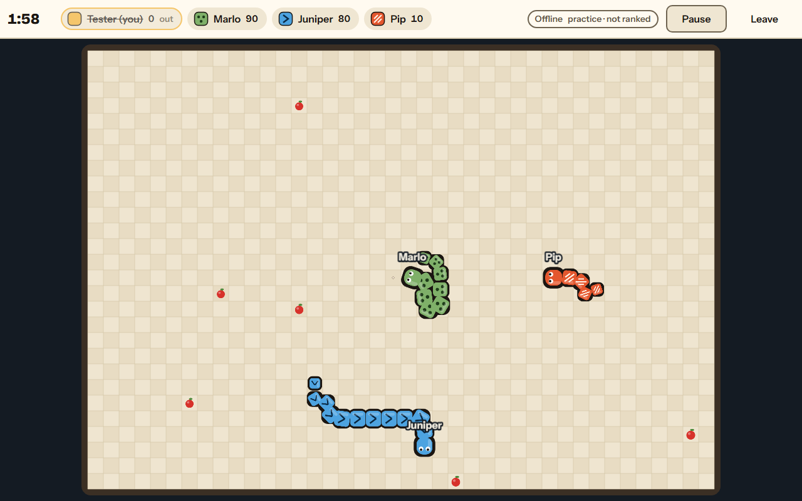

# Coilyard: Multiplayer Snake Arena

A browser game for 2–8 players, with public matchmaking, private rooms, spectators, and practice against bots.
The server decides movement, collisions, scores, and winners. You can play without creating an account.



## What you can do

- Join a public lobby with **Quick play**, or create a private room and share its five-character code or invite link.
- Play with up to eight people and let up to sixteen spectators watch a room.
- Practice against 1–7 bots at Easy, Normal, or Hard difficulty, entirely in your browser after the page loads.
- Choose Parchment, Kiln, or Tidepool arenas, and collect Surge, Aegis, and Trim power-ups.
- Use keyboard, swipe, or on-screen steering controls. Adjust sound, motion, and light/dark appearance in Settings.
- View round summaries, separate local practice/online records, and a leaderboard for the current game server.

This is a web application built with TypeScript, React 19, Phaser 3, Vite 8, Node.js, and WebSockets.
The [architecture guide](docs/ARCHITECTURE.md) explains the implementation with diagrams and source links.

## Run locally

### Requirements

- Node.js **22.12 or newer**.
- pnpm **11.28.3**, the version pinned in [package.json](package.json).
- A modern browser. No database, external service, or API key is required.

If pnpm is missing:

```bash
npm install -g pnpm@11.28.3
```

From the repository root:

```bash
pnpm install --frozen-lockfile
pnpm dev
```

Open **http://127.0.0.1:5720**. Leave the terminal running; press Ctrl+C to stop it.

| Process     | Local address         | Purpose                                          |
| ----------- | --------------------- | ------------------------------------------------ |
| Vite client | http://127.0.0.1:5720 | React/Phaser development app with hot reload     |
| Game server | http://127.0.0.1:5722 | HTTP API, WebSocket sessions, rooms, and matches |

Vite forwards `/api/*`, `/ws`, `/healthz`, and `/readyz` to the game server. Open the client address when developing.
The default proxy target matches the server's default port. For a separately hosted development backend, set
`SNAKE_SERVER` in the client process to its HTTP base URL.

Alternatively, `node scripts/bootstrap.mjs` checks Node/pnpm and installs dependencies.
Use `node scripts/bootstrap.mjs --browsers` when you also need Chromium for browser tests.

### Run a production build locally

Stop `pnpm dev` first because the production server uses the same backend port.

```bash
pnpm build
pnpm start
```

Open **http://127.0.0.1:5722**. One Node process now serves both the built client and the game backend.
The build produces `apps/client/dist/` and `apps/server/dist/main.mjs`.

## How to play

### Practice

1. Enter your name on the main menu.
2. Choose **Practice against bots**.
3. Select the number of bots, difficulty, and arena, then choose **Start practice**.
4. Steer after the three-second countdown. Practice can be paused and does not affect the server leaderboard.

### Play with friends

1. Open **Play online**, choose Private or Public, and select **Create room**.
2. Share the room code or invite link. Friends open the same app, enter the code, and choose **Join**.
3. Every seated player selects **Ready**. A match starts when at least two players are connected and everyone is ready.
4. After a round, review the scores. The room returns to its lobby after twelve seconds; ready up for another round.

To test multiplayer on one computer, use two tabs, choose different names, create a room in one, and join from the other.
Tabs share saved browser settings and the local guest ID; use separate browser profiles to test independent identities.

**Quick play** joins the fullest available public lobby or creates one, and marks you ready automatically.
Use **Watch** beside a room code to spectate. Joining after a round has started also makes you a spectator until a
later lobby has a free player seat.

### Controls and scoring

| Action                 | Control                                                 |
| ---------------------- | ------------------------------------------------------- |
| Steer                  | Arrow keys or W/A/S/D                                   |
| Steer on touch devices | Swipe on the arena or use the on-screen directional pad |
| Pause/resume practice  | P or the on-screen pause control                        |
| Mute/unmute            | M                                                       |
| Close a dialog         | Escape                                                  |

The arena is 40 × 28 cells. Rounds last up to 120 seconds, and end sooner when at most one snake remains.
Avoid walls, other bodies, your own body, and head-on collisions. Direct reversal into your neck is rejected.

| Event                                                           | Points |
| --------------------------------------------------------------- | ------ |
| Apple                                                           | 10     |
| Golden apple                                                    | 30     |
| Pellet from a crashed snake                                     | 5      |
| Another snake crashes into your body, and you survive that tick | 40     |
| Last snake standing                                             | 60     |

Most points wins; ties use body length, then eliminations. A complete tie is a shared win.
**Surge** doubles movement speed for five seconds, **Aegis** absorbs one crash within twelve seconds, and **Trim**
halves your body length without reducing it below four cells. The [rules section](docs/ARCHITECTURE.md#simulation-and-game-rules)
covers collision ordering and balance.

A dropped online connection triggers automatic retries. Your seat is held for fifteen seconds, but your snake keeps
moving while disconnected. Reconnecting can restore your seat even if the snake has already crashed.

## Configuration

[.env.example](.env.example) lists the server settings. The server reads environment variables; creating a root
`.env` file alone does not load it automatically. To use that file with a built server:

```bash
# Copy .env.example to .env with your editor, then edit the values.
pnpm build
node --env-file=.env apps/server/dist/main.mjs
```

Exported shell variables also work with `pnpm start`. Keep the defaults for the combined `pnpm dev` command;
Vercel independently assigns service ports through `PORT`.

| Variable                 | Default                                                 | Purpose                                                            |
| ------------------------ | ------------------------------------------------------- | ------------------------------------------------------------------ |
| `HOST`                   | `127.0.0.1`                                             | Listen interface; use `0.0.0.0` inside a container                 |
| `PORT`                   | `5722`                                                  | Game server port                                                   |
| `NODE_ENV`               | development behavior when unset                         | `production` rejects WebSockets without an Origin header           |
| `ALLOWED_ORIGINS`        | Same host; loopback origins also allowed in development | Comma-separated browser origins permitted to open sockets          |
| `ALLOW_NO_ORIGIN`        | `false` in production, `true` otherwise                 | Explicit override for non-browser WebSocket clients                |
| `LEADERBOARD_FILE`       | Empty: memory                                           | Optional JSON persistence on a long-lived host                     |
| `STATIC_DIR`             | Auto-detected next to the server bundle                 | Directory containing the built client                              |
| `MAX_CONNECTIONS_PER_IP` | `8`                                                     | Concurrent socket cap per client address                           |
| `MAX_ROOMS`              | `200`                                                   | Total room cap                                                     |
| `ROUND_TICKS`            | `1800`                                                  | Round duration at fifteen ticks per second                         |
| `TRUST_PROXY`            | `false`                                                 | Trust the first forwarded client IP only behind a controlled proxy |
| `LOG_LEVEL`              | `info`                                                  | `debug`, `info`, `warn`, or `error`                                |

## Development and checks

| Command                                | Purpose                                                       |
| -------------------------------------- | ------------------------------------------------------------- |
| `pnpm dev`                             | Start Vite and the game server with source watching           |
| `pnpm build`                           | Type-check/build the client and bundle the standalone server  |
| `pnpm start`                           | Run the built client and backend on port 5722                 |
| `pnpm lint`                            | Run ESLint, including code complexity limits                  |
| `pnpm format:check`                    | Check repository formatting                                   |
| `pnpm typecheck`                       | Check all workspace packages                                  |
| `pnpm test`                            | Run unit and integration tests                                |
| `pnpm test:coverage`                   | Run tests with a 90% statements/branches/functions/lines gate |
| `pnpm e2e`                             | Build and run desktop/mobile Playwright tests on port 5730    |
| `pnpm load -- --rooms 16 --seconds 40` | Exercise sixteen rooms with eight socket clients each         |
| `pnpm verify`                          | Lint, formatting, types, coverage tests, and production build |

Install Chromium before the first browser test: `pnpm exec playwright install chromium`.
Tests use their own server and do not need the development app to be stopped.

## Deployment

### A single long-lived host

Run the production bundle on one Node process, or build the included [Dockerfile](Dockerfile).
Put TLS and a WebSocket-capable reverse proxy in front of it. Preserve the public Host and Origin headers, forward
WebSocket upgrades, and set `ALLOWED_ORIGINS` to the app's public origin. Enable `TRUST_PROXY` only for a trusted proxy.
Use persistent storage for `LEADERBOARD_FILE` if scores must survive restarts.

The Docker image and GitHub Actions workflow are included but have not been verified in their target environments.
Rooms and resume tokens remain in memory; a server restart ends active matches.

### Vercel services

The root [vercel.json](vercel.json) defines two services in one project. Its service paths are relative to that file.
Keep this configuration at the repository root; do not add another `vercel.json` under `apps/client`.

To import the whole app in Vercel:

1. Import the GitHub repository and select the branch containing the root `vercel.json`.
2. Set **Root Directory** to **`./`**, the repository root. Do not select `apps/client` or `apps/server`.
3. Select **Services** as the **Application Preset**.
4. Choose **Refresh** if needed. The service list should contain **client** and **server**. A suggested single
   `app` service rooted at `apps/client` means the import is still looking at the frontend directory.
5. Import the multi-service project. Each service owns its build settings in `vercel.json`; do not replace them
   with a project-wide Vite build.

Refresh rereads the selected Git branch and project directory. It does not upload local edits or search parent
directories for this root configuration. Commit and push configuration changes before refreshing. The Vercel project
name is only a label; it does not determine which services are deployed.

| Service  | Root          | Public routes                                  |
| -------- | ------------- | ---------------------------------------------- |
| `client` | `apps/client` | `/` and all paths not assigned to the backend  |
| `server` | `apps/server` | `/api`, `/api/*`, `/ws`, `/healthz`, `/readyz` |

The client is a static Vite build. The server uses Node.js 22 and `src/vercel.ts`.
Browser requests use the same public domain: `/api/leaderboard` for standings and `/ws` for the game connection.
The client service has no server-side functions calling the server, and the server calls no other service. There are
therefore no internal-only services or service bindings in this deployment. Do not inject a private binding URL into
the browser bundle or set a binding variable manually. A future server-side caller should declare a binding on that
calling service and read the injected URL at function runtime.
`/api/stats` is public under the API rewrite. The Dockerfile is an alternative combined deployment of these applications.

```bash
pnpm dlx vercel@65.12.1 dev --local
# For a linked Vercel project:
pnpm dlx vercel@65.12.1 dev
```

Windows may need Developer Mode for Vercel's builder-cache symlinks. Without symlink access the CLI can fail before
starting the services.

**Treat the Vercel setup as a deployment preview.** Rooms, matchmaking, and reconnect tokens are owned by one process.
Players and HTTP requests routed to different function instances can see different state. WebSockets also have a
maximum function duration. A single region or container runtime does not guarantee one durable game instance.
The Vercel entrypoint disables file persistence and static serving; the client service owns the page.
See [deployment architecture](docs/ARCHITECTURE.md#deployment-and-operations) for the remaining production work.

## Troubleshooting

| Symptom                                    | Check                                                                                                        |
| ------------------------------------------ | ------------------------------------------------------------------------------------------------------------ |
| A port is already in use                   | Stop the old development/production process; the backend defaults to 5722                                    |
| Practice works but online play fails       | Confirm both `pnpm dev` processes are running and `http://127.0.0.1:5720/readyz` returns 200                 |
| A private room cannot be found             | Check the code and that every player uses the same server; private rooms are not accounts or permanent links |
| A match does not start                     | At least two seated players must be connected and all must be ready                                          |
| Production WebSocket handshake returns 403 | Check public Host/Origin forwarding and the exact `ALLOWED_ORIGINS` list                                     |
| A phone cannot reach `127.0.0.1`           | Loopback addresses refer to that device; use a LAN-facing host and your computer's LAN IP                    |
| Saved settings or records disappear        | Private browsing or blocked/full localStorage may prevent persistence                                        |
| Leaderboard resets                         | Memory is the default; configure a persistent file on a long-lived host                                      |

## Repository and documentation

```text
apps/client/        React screens, Phaser rendering, controls, networking, browser storage
apps/server/        HTTP/WebSocket gateway, sessions, rooms, match loop, leaderboard
packages/shared/    Deterministic simulation, protocol schemas, codecs, bots, prediction
e2e/                Playwright gameplay, accessibility, security, and mobile tests
scripts/            Setup, load tests, screenshots, and layout probes
docs/ARCHITECTURE.md Implementation guide, flowcharts, protocol, security, testing, limitations
docs/screenshots/   Gameplay and UI images
```

Documentation is kept in two maintained guides: this README for running and using the app, and
[ARCHITECTURE.md](docs/ARCHITECTURE.md) for how it works.

## Privacy and credits

No sign-in, chat, advertising, or analytics is built into the app. Settings, a random guest ID, and local records are
stored in your browser. The server keeps room/session state and optional per-server scores; guest IDs are excluded from
public leaderboard responses. Diagnostic server logs can include client IP addresses when reporting connection issues.

Bricolage Grotesque and Instrument Sans are bundled through Fontsource under the SIL Open Font License.
Arena artwork is drawn in code, and sounds are synthesized with Web Audio.
