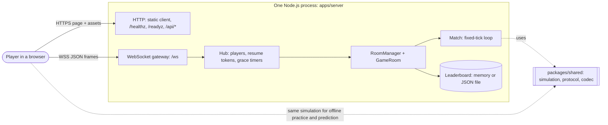
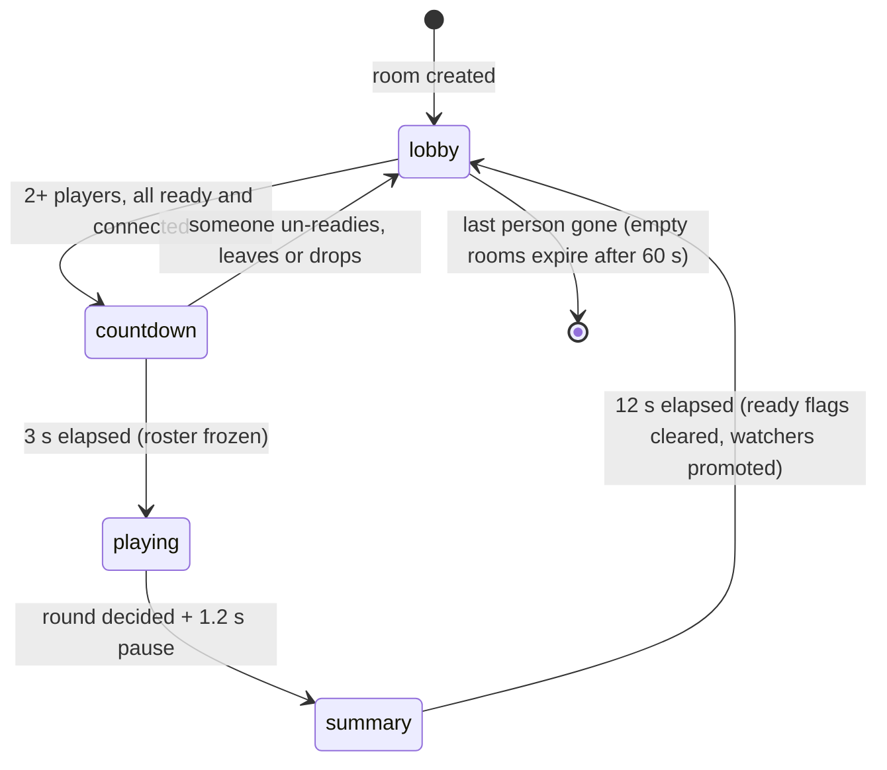
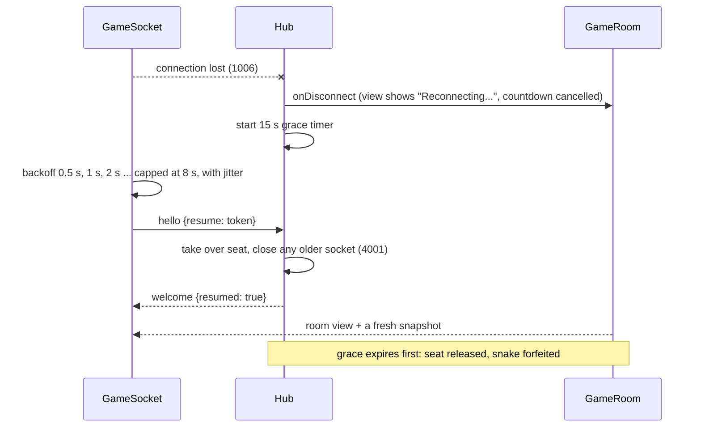
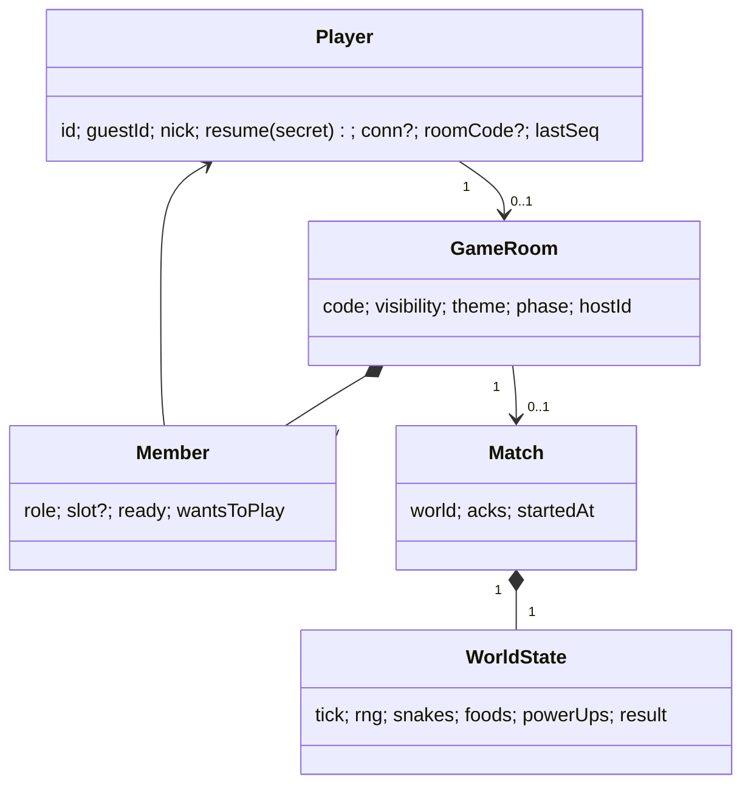

# Architecture

Coilyard is one Node.js process (HTTP + WebSocket) and one browser client. Everything that decides a result runs
on the server; the browser only sends intent and draws what it is told.

## 1. Context and containers



- **Container: client** (`apps/client`): React for menus, HUD and dialogs (real HTML, focus management, screen-reader
  semantics); Phaser 3 draws only the arena. They meet through one interface, `GameSource`, implemented by
  `PracticeGame` (offline) and `OnlineGame` (network).
- **Container: server** (`apps/server`): no database. State is in memory; the leaderboard can be mirrored to a JSON file.
- **Shared** (`packages/shared`): the pure, seeded simulation (`stepWorld`), the wire protocol (strict `zod`
  schemas), path codec, nickname sanitiser, prediction helper and bots. It has no I/O and no clock.

## 2. Room lifecycle



## 3. One tick, and what the client does with it

```mermaid
sequenceDiagram
  participant C as Client (OnlineGame)
  participant G as Gateway/Session
  participant R as GameRoom/Match
  participant S as shared.stepWorld
  C->>G: input {seq, dir}
  G->>G: schema check, token bucket
  G->>R: handleInput (seq must increase)
  R->>S: applyInput (queue a turn; never a position)
  Note over R,S: every 1000/15 ms
  R->>S: stepWorld(world)
  R-->>C: snapshot {tick, time, snakes, foods, events, ack{slot: seq}}
  C->>C: drop acked inputs, replay the rest on the server's snake (prediction)
  C->>C: queue other snakes' new cells for interpolation (shown ~133 ms late)
```

- **Clock**: the server stamps each snapshot with the scheduled time of its tick. The client estimates the server
  clock from ping round trips (lowest-RTT sample wins) and renders other snakes two ticks behind it.
- **Prediction**: the local snake is the server's last state plus the inputs it has not acknowledged, simulated up to the
  tick the server will be at when a message sent now arrives. It never predicts other snakes or collisions; a snapshot
  silently corrects it.

## 4. Reconnecting



## 4b. Data model (in memory)



There is no persistent schema and so no migrations. The only file is the optional leaderboard JSON
(`{ since, entries[] }`, validated on load; a corrupt file is renamed aside, never overwritten).

## 5. State ownership

| State                                | Owner                       | Notes                                                         |
| ------------------------------------ | --------------------------- | ------------------------------------------------------------- |
| Positions, scores, collisions, timer | `Match.world` on the server | the only authority                                            |
| Room membership, ready, host, phase  | `GameRoom`                  | broadcast as a `room` view on every change                    |
| Identity and resume token            | `Hub`                       | token never logged; guest ID only credits leaderboard results |
| Connection, room, match (client)     | `OnlineSession` store       | React reads it with `useSyncExternalStore`                    |
| Settings, local records              | `localStorage` (guarded)    | per browser; corrupt values fall back field by field          |

## 6. Why these boundaries

- Tests can drive rooms with a clock that is moved by hand and connections that are plain objects; the same room code
  then runs unchanged behind real sockets (see `apps/server/test/harness.ts` and `http-gateway.test.ts`).
- The client never trusts the server blindly either: every message is validated with the same schemas, and a snapshot
  whose snake paths leave the arena is dropped.
- Decisions and rejected alternatives are in `docs/adr/0001-stack-and-protocol.md`.
