# Coilyard architecture and implementation

This guide explains how the app is structured, how a turn reaches the screen, and where state and trust live.
Use the [README](../README.md) for installation, controls, configuration, and deployment commands.
The diagrams describe the implementation in this repository; proposed distributed hosting work is identified separately.

## Guide map

1. [System overview](#system-overview)
2. [Implementation decisions](#implementation-decisions)
3. [Startup and local request routing](#startup-and-local-request-routing)
4. [Browser architecture and screen flow](#browser-architecture-and-screen-flow)
5. [Online session and matchmaking flow](#online-session-and-matchmaking-flow)
6. [Room lifecycle](#room-lifecycle)
7. [Simulation and game rules](#simulation-and-game-rules)
8. [Networking, prediction, and rendering](#networking-prediction-and-rendering)
9. [Disconnect and reconnect flow](#disconnect-and-reconnect-flow)
10. [Data ownership and persistence](#data-ownership-and-persistence)
11. [HTTP and WebSocket contract](#http-and-websocket-contract)
12. [Security and resource limits](#security-and-resource-limits)
13. [Visual design and accessibility](#visual-design-and-accessibility)
14. [Testing and development workflow](#testing-and-development-workflow)
15. [Deployment and operations](#deployment-and-operations)
16. [Known limitations and extension points](#known-limitations-and-extension-points)

## System overview

Three pnpm workspace packages separate the visible interface, the game authority, and the reusable rules.

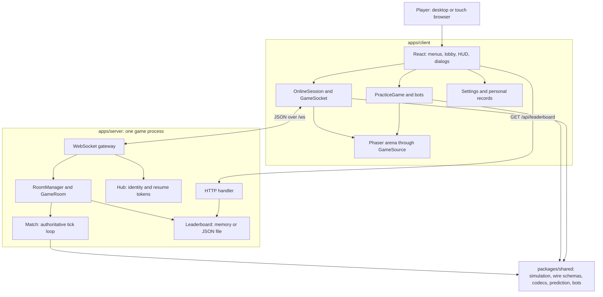

The **server** owns online results. The browser sends directions and room actions, never scores or positions.
The **shared package** contains deterministic rules without network, disk, or wall-clock access. It mutates the world
passed to it; it is not a second service. The **client** presents state and predicts movement to make controls responsive.

### Source map

| Area                  | Main files                                                                                                                                                                | Responsibility                                           |
| --------------------- | ------------------------------------------------------------------------------------------------------------------------------------------------------------------------- | -------------------------------------------------------- |
| App flow              | [App.tsx](../apps/client/src/App.tsx), [useAppFlow.ts](../apps/client/src/ui/useAppFlow.ts)                                                                               | Select screens and release running sessions when leaving |
| Browser game boundary | [source.ts](../apps/client/src/game/source.ts)                                                                                                                            | One interface shared by practice and online games        |
| Practice              | [practice.ts](../apps/client/src/game/practice.ts), [bot.ts](../packages/shared/src/bot.ts)                                                                               | Local simulation and configurable bots                   |
| Online client         | [gameSocket.ts](../apps/client/src/net/gameSocket.ts), [onlineSession.ts](../apps/client/src/net/onlineSession.ts), [onlineGame.ts](../apps/client/src/net/onlineGame.ts) | Transport, room state, prediction, and snapshots         |
| Rendering             | [ArenaScene.ts](../apps/client/src/render/ArenaScene.ts), [ArenaCanvas.tsx](../apps/client/src/ui/ArenaCanvas.tsx)                                                        | Phaser scene and React host                              |
| Server composition    | [main.ts](../apps/server/src/main.ts), [server.ts](../apps/server/src/server.ts), [vercel.ts](../apps/server/src/vercel.ts)                                               | Standalone and Vercel startup                            |
| Network boundary      | [http.ts](../apps/server/src/http.ts), [gateway.ts](../apps/server/src/gateway.ts), [session.ts](../apps/server/src/session.ts)                                           | HTTP, WebSocket admission, validation, action dispatch   |
| Room and identity     | [hub.ts](../apps/server/src/hub.ts), [roomManager.ts](../apps/server/src/roomManager.ts), [room.ts](../apps/server/src/room.ts)                                           | Players, room selection, seats, and room phases          |
| Match and rules       | [match.ts](../apps/server/src/match.ts), [step.ts](../packages/shared/src/sim/step.ts)                                                                                    | Scheduling and one authoritative simulation step         |
| Shared contract       | [protocol.ts](../packages/shared/src/protocol.ts), [wire.ts](../packages/shared/src/wire.ts), [codec.ts](../packages/shared/src/codec.ts)                                 | Strict schemas and compact world encoding                |

## Implementation decisions

The architecture makes local development possible without external infrastructure and keeps rules testable independently
of a browser or a live socket.

| Decision                                       | Reason and consequence                                                                                                                                                              |
| ---------------------------------------------- | ----------------------------------------------------------------------------------------------------------------------------------------------------------------------------------- |
| One seeded TypeScript simulation               | Practice and the server use the same rules; prediction reuses movement helpers. Identical seeds and ordered inputs can be replayed in tests.                                        |
| React UI plus Phaser 3 arena                   | Forms, menus, focus, and scoreboards remain semantic HTML; Phaser handles the frequently redrawn game board.                                                                        |
| A common GameSource interface                  | The renderer and HUD do not need separate practice and multiplayer implementations.                                                                                                 |
| Plain WebSockets through ws                    | Ordered JSON messages, explicit reconnect tokens, and rate limits remain visible in application code. Socket.IO's extra transport/reconnect layer is unnecessary for this protocol. |
| Strict Zod schemas on both sides               | Wrong types and unknown keys are rejected before application code consumes a message.                                                                                               |
| One game process                               | No Redis/database setup is needed. Live rooms and resume tokens disappear on restart and cannot be shared by multiple instances.                                                    |
| Optional JSON leaderboard                      | Simple persistence for a single long-lived host, explicitly labeled as a per-server leaderboard.                                                                                    |
| Vitest and React Testing Library               | The test toolchain shares Vite/TypeScript transforms and tests user-visible behavior. Playwright covers real browser integration.                                                   |
| Pinned dependencies and TypeScript strict mode | Builds use the lockfile; types make invalid state transitions and protocol drift easier to catch.                                                                                   |
| Code-generated art and self-hosted fonts       | The shipped game does not depend on remote assets, font requests, or an animation framework.                                                                                        |

These are implementation choices, not a claim that a single-process design supports production horizontal scaling.

## Startup and local request routing

### Standalone server startup

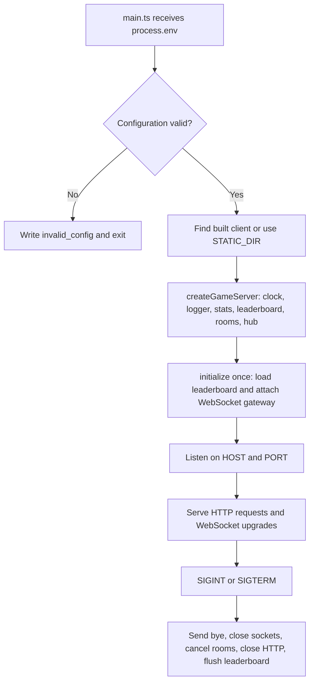

[config.ts](../apps/server/src/config.ts) validates integer ranges and log levels. Invalid settings fail early.
The default listener is `127.0.0.1:5722`; `main.ts` also locates a previously built client beside the server bundle.
[server.ts](../apps/server/src/server.ts) exposes `initialize()` separately from `start()` so a hosting platform can own
the listener. Concurrent initialization shares one promise and attaches a single upgrade handler.

### Development routing

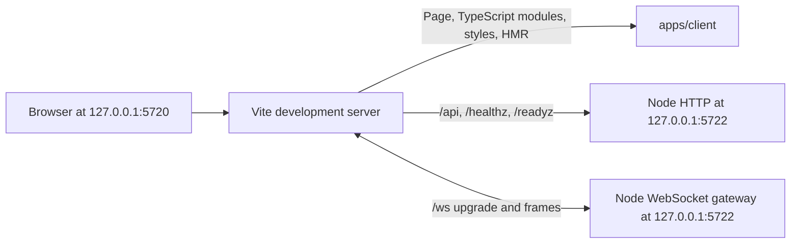

`pnpm dev` starts both workspace dev scripts. The [Vite configuration](../apps/client/vite.config.ts) uses the same
backend port as the Node default. A `SNAKE_SERVER` override is only a standalone development proxy target.
In Vercel services mode, Vercel routes API and socket traffic before it reaches Vite.

## Browser architecture and screen flow

[main.tsx](../apps/client/src/main.tsx) mounts the React app. Settings are restored from guarded localStorage reads.
`useAppFlow` owns top-level screen state and creates a practice game or an online session only when the player chooses
that path. An invite query such as `?room=ABCDE` is validated, but does not connect until accepted.

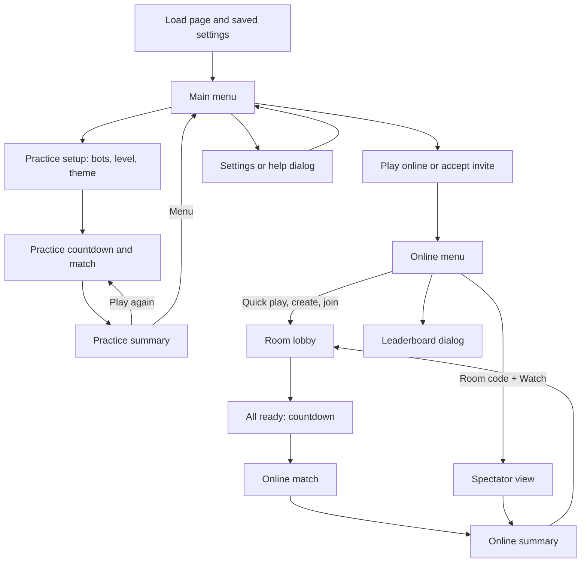

The online branch has its own session state, containing connection status, the current player, the room view,
an optional `OnlineGame`, results, and notices. React observes stores through `useSyncExternalStore`.
UI actions become protocol messages; the client does not invent a successful room join while offline.

### Rendering boundary

`GameSource` exposes `frame(nowMs)`, `turn(dir)`, `hud()`, event/HUD subscriptions, `dispose()`, and optional
practice pausing. `PracticeGame` and `OnlineGame` implement it.

The Phaser scene reads interpolated display frames and draws the arena, snakes, food, and effects. React reads HUD
updates and renders the timer, score list, network indicator, overlays, and dialogs. Leaving a screen disposes its
resources; leaving online mode closes the logical socket and removes its subscriptions.

Practice creates a seeded local world, uses shared bot decisions, and advances the same simulation in the browser.
Its round results update local practice records and never go to the server leaderboard.

## Online session and matchmaking flow

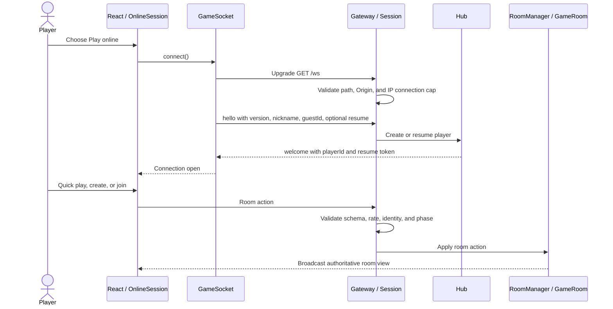

There are three different identifiers:

| Identifier   | Created by                                | Used for                                                                |
| ------------ | ----------------------------------------- | ----------------------------------------------------------------------- |
| Guest ID     | Browser settings                          | Credit per-server leaderboard results and retain a local guest identity |
| Player ID    | Server Hub                                | Address the current player and room membership                          |
| Resume token | Server Hub using cryptographic randomness | Prove ownership of a temporarily disconnected session                   |

A guest ID or nickname is not an authenticated account. The resume token is kept by the active `GameSocket` object;
it is not a login credential persisted across a full page reload.

`RoomManager` stores rooms by code and generates collision-checked five-character codes from an alphabet that avoids
ambiguous characters. Quick play chooses the fullest public lobby with an open seat, or creates a public room.
It is deliberately simple: there is no skill, region, or latency matching.

## Room lifecycle

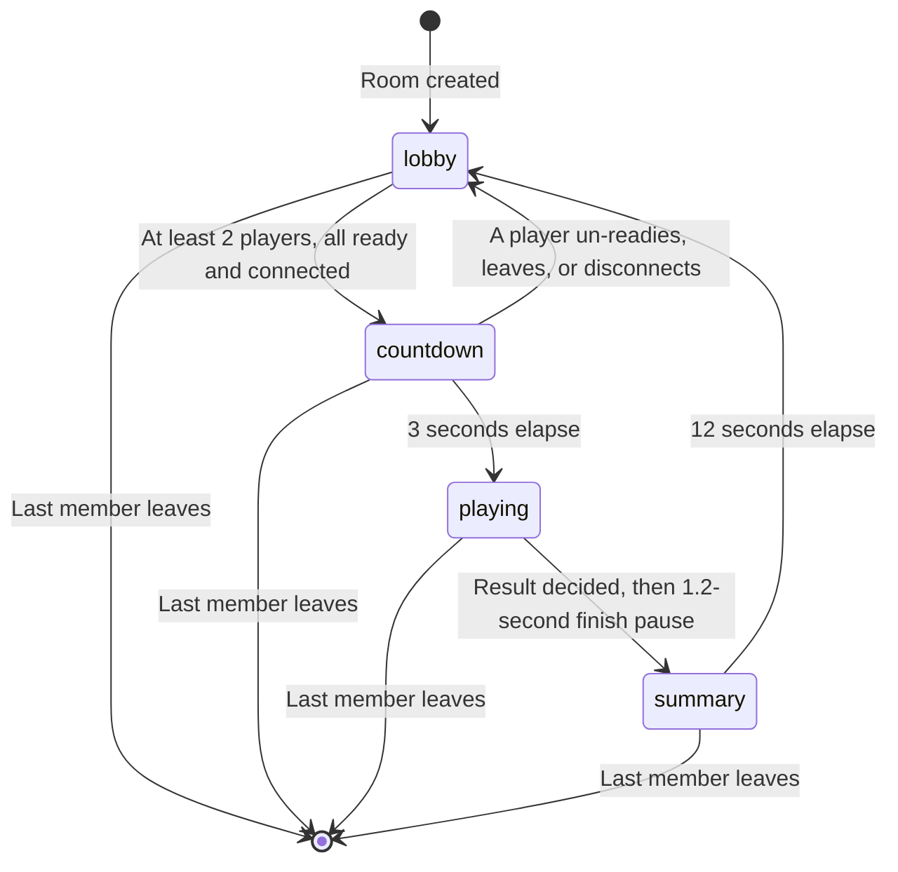

`GameRoom` owns visibility, arena theme, host, members, roles, slots, readiness, phase timers, and its optional match.

- A lobby seats at most eight players; a room also permits sixteen spectators.
- Every seated player must be ready and connected. Quick play supplies an initial ready flag.
- Starting a match freezes its participant roster and resets each player's input sequence.
- Late joiners watch. Spectators who wanted to play can be promoted when the room returns to the lobby and seats exist.
- The host may change the theme in the lobby. Host ownership transfers when the host leaves.
- Leaving during a match forfeits that player's snake.
- Returning to the lobby clears ready flags.
- A room with no members is destroyed immediately. When members remain but none are connected, a sixty-second expiry
  provides a final cleanup path; individual disconnected seats also have their fifteen-second grace timers.

The server serializes a room broadcast once and sends it to each connected member, rather than encoding it per socket.

## Simulation and game rules

[constants.ts](../packages/shared/src/constants.ts) is the source of gameplay numbers.
[sim/](../packages/shared/src/sim/step.ts) separates world creation, input, movement, collision resolution, and round results.

| Setting                                 | Default                                         |
| --------------------------------------- | ----------------------------------------------- |
| Board                                   | 40 × 28 cells with solid walls                  |
| Players                                 | 2–8 online; practice has one human and 1–7 bots |
| Tick rate                               | 15 ticks/second, about 66.7 ms/tick             |
| Normal movement                         | One cell every two ticks: 7.5 cells/second      |
| Surge movement                          | One cell every tick: 15 cells/second            |
| Round                                   | 1800 ticks / 120 seconds                        |
| Start length                            | Four cells                                      |
| Queued turns                            | At most two                                     |
| Countdown / final-crash pause / summary | 3 seconds / 1.2 seconds / 12 seconds            |

### How one tick works

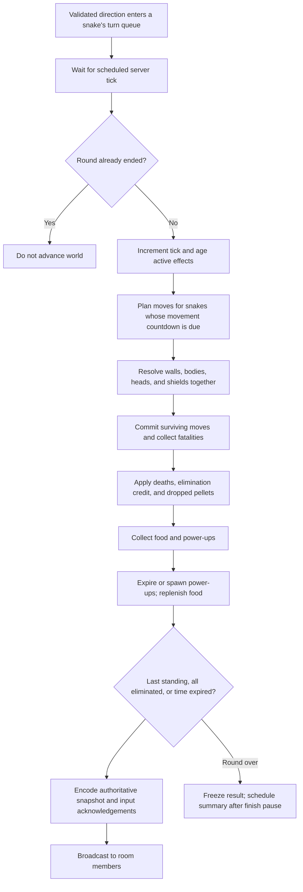

The seeded random generator makes world creation and spawns reproducible for a given ordered execution.
The simulation does not inspect a socket or decide when real time has passed; `Match` supplies scheduling.

The match scheduler tracks the next scheduled tick instead of using a drifting interval. It catches up at most five
late ticks per callback. If the process falls further behind, it reanchors the clock and records a warning rather than
running an unbounded catch-up loop. Snapshots carry scheduled simulation time.

### Input and collision rules

Directions are `0 = up`, `1 = right`, `2 = down`, and `3 = left`.
Repeating a heading adds no turn; reversing directly into the neck is rejected. Rapid valid turns can queue up to two
moves ahead. Per-round sequence numbers prevent a duplicate or older input from being applied again.

All proposed movement is considered together so processing order does not decide the result.

| Situation                                            | Resolution                                                                     |
| ---------------------------------------------------- | ------------------------------------------------------------------------------ |
| Head moves outside the board                         | Snake crashes                                                                  |
| Head enters its own or another body                  | Snake crashes; a surviving other body owner can earn elimination points        |
| Tail vacates its cell this move                      | Cell is free; a growing or stationary tail remains occupied                    |
| Two heads enter the same cell or exchange head cells | Both crash without an elimination credit                                       |
| A mover hits a stationary snake's head               | Mover crashes; stationary snake can be credited                                |
| Aegis absorbs a crash                                | Shield is consumed; the move is canceled and the snake stumbles for five ticks |

A fatal snake's body is removed together with other fatalities. Pellets are placed on every third segment, up to eight,
where the resulting cells are free. A body owner dying in the same tick does not receive elimination credit.

### Food, powers, and round results

| Pickup or result | Points        | Growth or effect                                                                    |
| ---------------- | ------------- | ----------------------------------------------------------------------------------- |
| Apple            | 10            | Add one segment                                                                     |
| Golden apple     | 30            | Add three segments; one in eight ordinary food spawns is golden                     |
| Crash pellet     | 5             | Add one segment                                                                     |
| Elimination      | 40            | No growth; body owner must survive the tick                                         |
| Last standing    | 60            | Bonus before standings are ranked                                                   |
| Surge            | None directly | Double speed for five seconds                                                       |
| Aegis            | None directly | Absorb one crash within twelve seconds; stumble for five ticks                      |
| Trim             | None directly | Keep half the body, rounded up, with a minimum length of four; clear pending growth |

At most two power-ups sit on the board. The first opportunity is at eight seconds, then every ten seconds;
uncollected powers expire after fifteen seconds and spawn at least two cells from walls.
Weights favor Surge (3) over Aegis (2) and Trim (2). Faster movement adds steering risk, and the shield's brief stumble
gives nearby opponents a chance to react.

A round ends when only one or no snakes remain, or the timer expires. Results sort by score, then body length, then
eliminations. Equal values share a rank and can share the win. The stable slot ordering does not break a complete tie.
The frozen online roster supplies names and guest IDs when the room records server-computed standings.

## Networking, prediction, and rendering

### A player's turn from keypress to visible movement

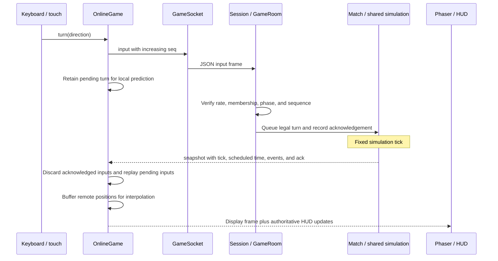

[ClockSync](../apps/client/src/net/clockSync.ts) records application-level ping/pong exchanges every two seconds.
It retains eight samples, uses the lowest round-trip sample for the clock offset, and smooths RTT and jitter.
This estimates server time without equating browser `performance.now()` with server time.

**Local prediction:** the latest authoritative snake is the base. Unacknowledged inputs are replayed toward the estimated
server tick plus half an RTT, with a bounded prediction horizon. This predicts the player's movement, not ownership of a
collision, a pickup, or a win. A newer snapshot corrects the displayed state.

**Remote interpolation:** other snakes are displayed about two simulation ticks behind the estimated server time.
[SnakeTweener](../apps/client/src/game/tween.ts) turns discrete body cells into smooth display positions.
An old snapshot is ignored; malformed or geometrically invalid snapshots are dropped.

**HUD and feedback:** authoritative events drive pickup/crash feedback and sound. The scoreboard, timer, power status,
network label, and summary remain React HTML. Lower motion settings suppress camera shake and traveling effects.

**Wire size:** a snake body is represented by a head coordinate plus a path string containing one direction per additional
segment, rather than a JSON coordinate object for every segment. This reduces repeated field/number overhead.
The [wire codec](../packages/shared/src/wire.ts) reconstructs a validated world view.

## Disconnect and reconnect flow

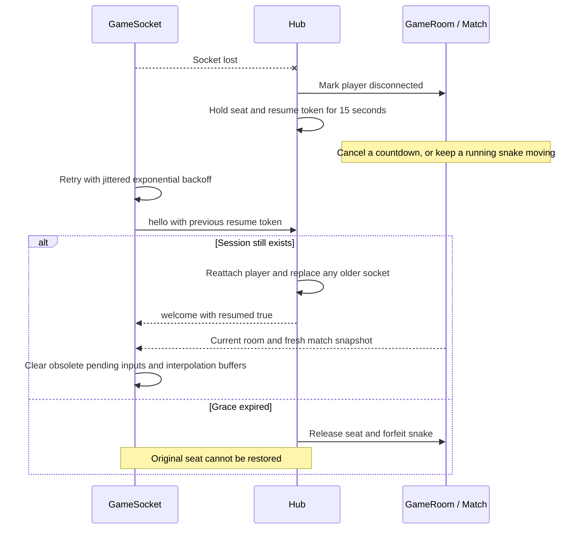

Retry delay starts with a 500 ms exponential base and caps at an 8000 ms base, multiplied by jitter from 0.5 to 1.
The client stops after twelve unsuccessful attempts by default and exposes retry UI.
Protocol/violation close code 1008 and replacement code 4001 are terminal rather than blindly retried.

Inputs sent while offline are rejected locally, not buffered for later transmission. Old steering commands arriving
after reconnection would be harmful. Reconnection preserves a seat, not survival: a snake can hit a wall during the gap.

Server-level WebSocket ping/pong runs independently every ten seconds. A socket that misses its next heartbeat is
terminated. Shutdown sends `bye` and closes sockets; a lost process cannot send that notice.

## Data ownership and persistence

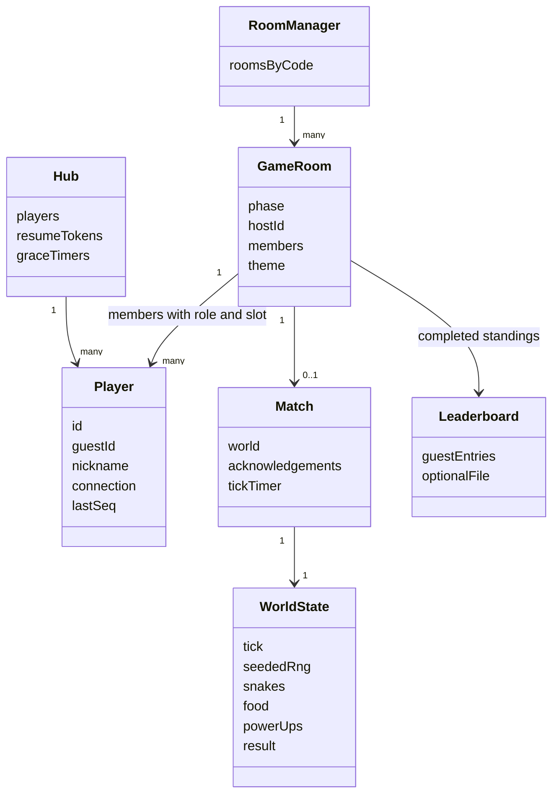

| State                                                 | Owner                | Lifetime                                                      |
| ----------------------------------------------------- | -------------------- | ------------------------------------------------------------- |
| Online positions, collisions, effects, points, result | Server Match world   | One round / one process                                       |
| Room code, readiness, seats, host, theme, phase       | GameRoom             | Until destroyed or server stops                               |
| Player connection and secret resume token             | Hub                  | Live session plus reconnect grace                             |
| Client connection/room/current game                   | OnlineSession store  | Active online screen                                          |
| Predicted local movement and remote interpolation     | OnlineGame           | Active round; reset on reconnection                           |
| Settings, guest ID, practice and online local records | Browser localStorage | Until cleared or storage becomes unavailable                  |
| Server win/score totals                               | Leaderboard          | Memory by default; optional durable file on a long-lived host |

[leaderboard.ts](../apps/server/src/leaderboard.ts) keeps at most 5000 entries and exposes ranked public rows without guest
IDs. A configured JSON file contains `since` and entries, is validated when loaded, and is written through an atomic
replacement. Corrupt content is renamed aside instead of being overwritten blindly. This is single-host persistence,
not replication, authentication, or a database schema.

Browser storage parsing is defensive: unavailable storage, malformed JSON, or invalid fields fall back to defaults.
Practice and online personal records are counted separately, and a completed result is counted once.

## HTTP and WebSocket contract

The strict schemas in [protocol.ts](../packages/shared/src/protocol.ts) are the executable source of truth.
Protocol version is **1**. Static documents summarize the shape; change the shared schema and both consumers together.

### HTTP

GET and HEAD are supported; other methods receive 405 with an Allow header.

| Path                                | Response                                                                 |
| ----------------------------------- | ------------------------------------------------------------------------ |
| `/healthz`                          | 200 with `{"status":"ok"}`                                               |
| `/readyz`                           | 200 when initialized, otherwise 503                                      |
| `/api/stats`                        | Uptime, room/player/connected counts, counters, and tick-lag percentiles |
| `/api/leaderboard`                  | Persistence mode, per-server scope, start time, and public score rows    |
| Static paths on the standalone host | Built files; extensionless page paths can fall back to index.html        |
| Unknown API or missing asset        | 404                                                                      |

The standalone HTTP handler sets security headers on its responses, serves fingerprinted assets with immutable caching,
and uses no-store for JSON. The Vercel Node entrypoint does not serve the static client; Vercel's client service does.
Headers applied by the Node handler should not be assumed to cover a separately served static frontend.

### Client messages

Each text frame holds one JSON object, with a 2048-byte incoming limit.

| Type          | Main fields                 | Meaning                                               |
| ------------- | --------------------------- | ----------------------------------------------------- |
| `hello`       | `v, nick, guestId, resume?` | First message; identify or resume within five seconds |
| `quickplay`   | None                        | Join/create a public lobby, ready                     |
| `create_room` | `visibility, theme`         | Open a room                                           |
| `join_room`   | `code, spectate?`           | Join by code or watch                                 |
| `ready`       | `ready`                     | Change readiness in lobby/countdown                   |
| `set_theme`   | `theme`                     | Host changes lobby theme                              |
| `leave_room`  | None                        | Release membership; forfeit if playing                |
| `input`       | `seq, dir`                  | Submit a directional intent                           |
| `ping`        | `t`                         | Measure server clock/RTT                              |

### Server messages

| Type        | Main content                                                                                   |
| ----------- | ---------------------------------------------------------------------------------------------- |
| `welcome`   | Player ID, sanitized nickname, resume token, server time, resumed flag                         |
| `room`      | Room view or null: phase, theme, host, members, roles, ready/connected flags, countdown timing |
| `snapshot`  | Tick, scheduled time, end tick, encoded snakes, food, powers, events, input acknowledgements   |
| `round_end` | End reason, standings, winners, participant names, ranked flag                                 |
| `pong`      | Client timestamp and server timestamp                                                          |
| `error`     | Stable error code and user-readable message                                                    |
| `bye`       | Shutdown, replacement, idle, or kick reason                                                    |

Error codes cover malformed messages/names, incompatible versions, rate limiting, missing/full rooms, invalid membership,
host-only actions, wrong phases, expired sessions, and server capacity.
WebSocket close codes include 1001 for shutdown, 1003 for binary frames, 1008 for protocol/violation failure,
1009 for oversize frames, 4000 for hello timeout, and 4001 for session replacement.

## Security and resource limits

The browser is an untrusted input source. A room code is a discovery mechanism, not a password.
The app protects game fairness and limits common abuse; it does not authenticate guest accounts.

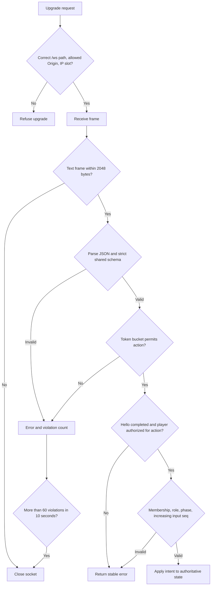

| Protection                | Implementation                                                                            |
| ------------------------- | ----------------------------------------------------------------------------------------- |
| Scores and speed          | Clients cannot submit results; server rules own them                                      |
| Replay and turn abuse     | Per-round increasing sequence, no direct reversal, two-turn queue                         |
| Control-message rate      | 10/second, burst 20                                                                       |
| Input rate                | 40/second, burst 40; excess inputs dropped                                                |
| Socket and room caps      | Eight sockets/IP and 200 rooms by default; configurable                                   |
| Slow readers              | Skip replaceable snapshots above 256 KiB buffered; terminate above 4 MiB                  |
| Cross-site socket use     | Same-host Origin or explicit allow-list; production rejects a missing Origin by default   |
| Nickname and invite input | Sanitization, length restrictions, validated invite syntax, React text rendering          |
| Static traversal          | Reject decoded parent segments/NUL bytes and require paths beneath the configured root    |
| Resume tokens             | 24 random bytes, secret redaction in logs, ownership transfer closes the older connection |
| Server errors             | Stable public errors; implementation stack traces are not sent to players                 |
| Dependencies              | Pinned versions, lockfile, pnpm install-script allow-list                                 |

The standalone HTTP policy includes CSP, frame denial, MIME protection, no-referrer, restrictive permissions,
and same-origin opener/resource policies. HSTS is added when the forwarded scheme is HTTPS.
TLS belongs to the hosting/reverse-proxy layer. Trust forwarded client IPs only behind a proxy you control.
IP addresses can appear in gateway diagnostics; logging is not an analytics service.

Residual risks include unauthenticated guest IDs, look-alike nicknames, process-local state loss, and network-level DoS.
There is no chat surface. Leaderboard totals are suitable for casual play, not a verified competitive identity system.

## Visual design and accessibility

The UI uses a tabletop direction: crisp outlines, printed snake patterns, warm accents, and quieter motion.
Parchment provides a light arena; Kiln and Tidepool provide darker alternatives. The game uses handwritten CSS and
generated Phaser art, rather than importing a third-party UI template.

- React provides labels, buttons, dialog focus trapping, Escape dismissal, focus return, a skip link, and live announcements.
- Eight snake patterns accompany eight colors, and scoreboard swatches repeat those patterns.
- Power-ups have different shapes as well as colors; their rings show remaining time.
- Settings support light/dark/system appearance and reduced motion, including the OS preference.
- Touch steering sits below the arena; tall screens can rotate the board presentation to keep cells usable.
- Text/control contrast and arena outlines are checked with the local contrast utility and tests.
- Bricolage Grotesque and Instrument Sans are bundled through Fontsource with SIL OFL licensing.
- Sounds are synthesized locally with Web Audio; no remote font or audio requests are required.

Design research considered inspiration/palette tools, but their layouts or components were not copied.
The useful retained method was choosing explicit color roles and validating contrast locally.
The earlier alternative of a glow-heavy neon board was rejected because it obscures pattern outlines and increases glare.

Canvas gameplay still has accessibility limits: live announcements and an HTML scoreboard do not provide a complete
nonvisual way to navigate the board. Automated axe checks do not replace manual assistive-technology testing.

## Testing and development workflow

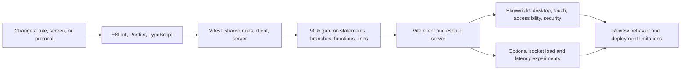

| Test layer                      | What it establishes                                                                                                     | Where                                        |
| ------------------------------- | ----------------------------------------------------------------------------------------------------------------------- | -------------------------------------------- |
| Shared unit tests               | Movement, simultaneous collisions, effects, tie rules, encoding, prediction, bots, strict wire schemas                  | `packages/shared/test/`                      |
| Server unit/room tests          | Deterministic timers, membership/ready transitions, expiry, reconnect, leaderboards, logging/config                     | `apps/server/test/`                          |
| Real HTTP/WebSocket integration | Admissions, rate limits, full room flow, shutdown, platform-owned listener initialization                               | `http-gateway.test.ts`                       |
| Client unit/component tests     | Screens, controls, settings, socket backoff, online state, prediction, storage                                          | `apps/client/test/`                          |
| Browser tests                   | Complete practice/online flows, spectators, mobile layout, keyboard flow, axe, CSP/header checks on the standalone host | `e2e/`                                       |
| Load/latency tests              | Multiple real clients, tick lag, snapshot delivery, delayed and disconnected sockets                                    | `scripts/load-test.ts`, server latency tests |

`FakeClock` and fake connections let room/match tests advance time without waiting for a real round.
Real socket tests verify that these same objects work behind actual network boundaries.

The coverage exclusions are narrow: Phaser drawing modules under `render/`, bootstrap entry files `main.ts`/
`main.tsx`, and declaration files. Browser tests exercise rendering integration. Test callback size and complexity
exceptions are explicitly scoped in [eslint.config.js](../eslint.config.js); production limits still apply.

The current command list is maintained in the README; rerun checks when changing the implementation.
Unit/browser coverage and local load measurements do not establish production capacity.

Not established by the automated suite: real mobile network behavior, Safari/Firefox compatibility, real GPU frame
rate, audio quality by ear, manual NVDA/VoiceOver usage, Core Web Vitals, a live TLS deployment, Docker deployment,
or a successful remote GitHub Actions execution.

## Deployment and operations

### Local production and a single host

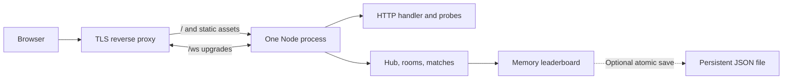

A production build uses Vite for assets and esbuild to bundle server dependencies into one ESM entrypoint.
The Dockerfile builds the workspace and copies the server bundle and client dist into a Node 22 runtime image.

The reverse proxy must preserve the public host and support WebSocket upgrades, for example:

```nginx
location / {
  proxy_pass http://127.0.0.1:5722;
  proxy_http_version 1.1;
  proxy_set_header Upgrade $http_upgrade;
  proxy_set_header Connection "upgrade";
  proxy_set_header Host $host;
  proxy_set_header X-Forwarded-For $remote_addr;
  proxy_set_header X-Forwarded-Proto $scheme;
  proxy_read_timeout 120s;
}
```

Configure the public origin, TLS, a trusted proxy, and persistent storage for optional scores.
Logs are JSON on stdout; counters and tick-lag percentiles are available at `/api/stats`.
`/healthz` establishes liveness; `/readyz` establishes initialization readiness.
Neither probe proves every room is healthy, nor does a public stats endpoint provide authentication.

`SIGINT`/`SIGTERM` trigger a `bye` broadcast, socket close, timer/room cleanup, HTTP shutdown, and leaderboard flush.
Deploy compatible server/client versions together; protocol mismatch is refused rather than guessed.
For rollback, restore the paired client dist and server bundle. There are no database migrations.

### Vercel services

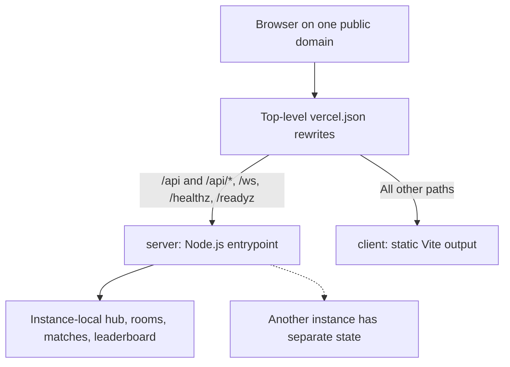

Services are independently built. Public rewrites remain at the root, and framework/build/runtime options belong to
their service. The Node adapter calls `initialize()` and exports the HTTP server for platform-managed requests/upgrades;
it disables static serving and local-file persistence and trusts the platform's forwarded client IP header.

The browser talks to public same-origin URLs. There is no backend-to-backend network call in this layout, so no caller
binding is declared. Bindings would be appropriate if a runtime function later needed a private service; their URLs must
not be set manually, baked into a Vite bundle, or read during a build or middleware execution.

The current configuration is a preview deployment arrangement. Function instances can scale or restart, new sockets and
HTTP requests can reach different instances, and connections have maximum durations. Room ownership, clock scheduling,
resume tokens, and standings are not coordinated across those instances. A container service does not by itself repair
those properties.

Before using this design for distributed multiplayer, define how a room gets exactly one active authority, how every
member reaches it, how results/presence survive failures, and how clients rejoin after ownership changes.
A shared database alone does not replace a deterministic room owner and its tick loop.
Alternatively keep the authoritative game server on one long-lived host.

Platform references: [services](https://vercel.com/docs/services),
[service routing](https://vercel.com/docs/services/routing),
[bindings](https://vercel.com/docs/services/bindings), and
[WebSocket lifecycle](https://vercel.com/docs/functions/websockets).
Local Vercel testing was blocked by Windows builder-cache symlink permissions; the exported Node server was smoke-tested
directly for readiness, API responses, and a WebSocket welcome.

## Known limitations and extension points

| Limitation                                        | Implication or next design step                                                               |
| ------------------------------------------------- | --------------------------------------------------------------------------------------------- |
| Single process owns rooms                         | Restarts end matches; horizontal deployment needs room ownership and shared coordination      |
| Resume keeps a seat, not a snake alive            | The simulation keeps running during network loss                                              |
| Server leaderboard is per instance                | File persistence suits one host; distributed totals need durable storage and validated writes |
| Guest identity is unauthenticated                 | Accounts and competitive ranking require an authentication/identity design                    |
| Quick play fills available public lobbies         | Skill, region, or latency matchmaking is not implemented                                      |
| Bots are practice-only                            | They never fill online rooms or contribute ranked results                                     |
| Page must already be loaded for offline practice  | No service worker or installable PWA is implemented                                           |
| Phaser dominates client bundle size               | Profile actual devices before splitting or changing the renderer                              |
| No chat, replays, localization, or account system | Add explicit product/protocol/state boundaries before introducing them                        |
| Automated browser coverage is Chromium-based      | Validate other browsers, real devices, audio, and accessibility manually                      |

When adding a rule, start in shared constants/types and the simulation tests, then update the wire schema if it changes
the transmitted state. When adding an online action, follow the path `protocol → Session → GameRoom → OnlineSession → UI`.
When changing presentation, keep the `GameSource` boundary so practice and online play remain consistent.
Keep user-facing setup in the README and implementation explanations in this guide.
